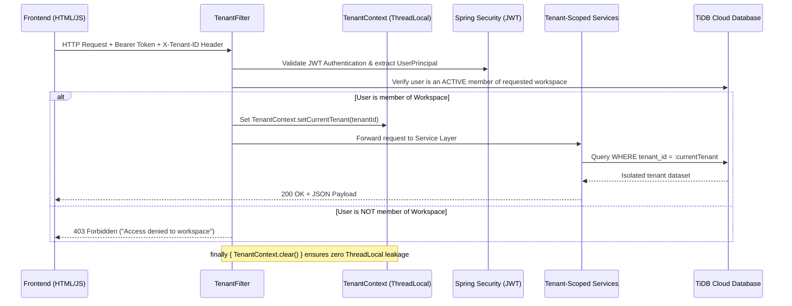

# NexSpace | Multi-Tenant Workspace & Team Collaboration SaaS

[](https://openjdk.org/)
[](https://spring.io/projects/spring-boot)
[](https://tidbcloud.com/)
[](https://spring.io/projects/spring-security)
[](https://www.brevo.com/)
[](https://multi-tenant-workspace-a0uq.onrender.com)

> **Live Demo:** [https://multi-tenant-workspace-a0uq.onrender.com](https://multi-tenant-workspace-a0uq.onrender.com)  
> **Source Code:** [https://github.com/Bibek9178123/multi-tenant-workspace](https://github.com/Bibek9178123/multi-tenant-workspace)

---

## 📖 Overview

**NexSpace** is a production-grade, enterprise multi-tenant SaaS workspace and team collaboration platform. It implements a **Shared Database with Discriminator Column (`tenant_id`)** multi-tenancy architecture, featuring thread-safe context binding, fine-grained Role-Based Access Control (RBAC), asynchronous transactional email pipelines with strict tenant isolation, and automated Stripe billing webhooks.

---

## 🏛️ Multi-Tenancy Architecture

```
HTTP Request (Header: X-Tenant-ID + Bearer JWT)
         │
         ▼
┌───────────────────┐     Validates JWT &
│   TenantFilter    │ ──► Checks Workspace Membership in TiDB
└─────────┬─────────┘
          │
          ▼
┌───────────────────┐     Binds active tenant ID to thread;
│   TenantContext   │ ──► cleaned up in finally { TenantContext.clear(); }
└─────────┬─────────┘
          │
          ▼
┌───────────────────┐     Applies WHERE tenant_id = :activeTenant
│  Service / JPA    │ ──► Guarantees zero cross-tenant data leakage
└───────────────────┘
```

### 1. Data Isolation Model: Shared Database with Discriminator Column
- **Shared Schema**: Every tenant-scoped entity (`Project`, `Task`, `ActivityLog`, `WorkspaceMember`, etc.) inherits from `BaseTenantEntity` which mandates the `tenant_id` discriminator column.
- **Automatic Partition Stamping**: When saving entities, `@PrePersist` automatically binds `tenant_id` from `TenantContext.getCurrentTenant()`.
- **Tenant Isolation Enforcement**: Service and repository layers strictly scope lookups by `tenantId`. A user from `Tenant_A` cannot query, modify, or delete data belonging to `Tenant_B`.

### 2. Request Lifecycle & ThreadLocal Management


---

## 🚀 Key Features

### 🏢 Workspace & Tenant Management
- **Instant Workspace Onboarding**: Self-service workspace creation with automatic slug generation (`acme-studio`).
- **Dynamic Workspace Switcher**: Switch between organizations instantly without logging out. The client automatically adjusts the `X-Tenant-ID` header and re-fetches tenant datasets.
- **Tenant Settings & Tier Upgrades**: Toggle between `FREE`, `PRO`, and `ENTERPRISE` tiers with automatic billing confirmation emails.
- **Workspace Deletion**: Secure two-step confirmation deleting all tenant-isolated records cleanly.

### 👥 Role-Based Access Control (RBAC)
- **`OWNER`**: Full administrative authority, manage billing plans, update workspace settings, invite members, or delete workspace.
- **`ADMIN`**: Manage workspace settings, invite team members, create and assign projects and tasks.
- **`BILLING_ADMIN` (Isolated Financial Role)**: Exclusive permissions to manage Stripe upgrades, view invoices, and handle subscriptions, while strictly blocked from mutating engineering tasks or projects.
- **`MEMBER`**: Standard contributor — Create, update, and manage tasks across Kanban boards.
- **`VIEWER`**: Read-only auditor — View projects, tasks, and audit trails without mutation rights.

### ✉️ Transactional Email Service & Tenant-Isolated Outbox
- **Asynchronous Delivery (`@Async`)**: Non-blocking email dispatch powered by a dedicated thread pool and Brevo SMTP over TLS/STARTTLS.
- **Strict Tenant-Isolated Outbox**: Sent emails are tagged with `tenantId` and `workspaceName`. Workspace A owners can only inspect emails triggered within Workspace A (`WHERE tenant_id = :activeTenantId`).
- **Rich Responsive HTML Templates**:
  - 🚀 **Welcome Email**: Sent upon initial registration.
  - 👥 **Team Invitations**: Includes secure role badge and direct join link.
  - 💳 **Billing & Payment Alerts**: Upgrade receipts, tier changes, and payment status alerts.
  - 📋 **Task Assignments**: Direct notifications sent when a teammate assigns a task.
- **Dual-Mode Delivery**: Live SMTP delivery with an automatic fallback to an in-memory virtual dev outbox with HTML inspection modal.

### 💳 Stripe Billing & Event-Driven Webhooks
- **Subscription Tiers**: Free ($0/mo), Pro ($29/mo), and Enterprise ($99/mo).
- **Asynchronous Webhook Processing**:
  - `checkout.session.completed` ➔ Upgrades plan, records `stripe_customer_id` and `stripe_subscription_id`, and dispatches upgrade email.
  - `customer.subscription.updated` ➔ Synchronizes subscription tier changes.
  - `customer.subscription.deleted` ➔ Automatically downgrades workspace to `FREE`.
  - `invoice.payment_succeeded` ➔ Logs payment confirmation receipt in activity audit trail.
  - `invoice.payment_failed` ➔ Flags workspace account as `PAST_DUE`.
- **Built-in Webhook Simulator**: 1-Click developer playground to test webhook events without `ngrok` or Stripe CLI.

### 📋 Interactive Kanban Board & Task Management
- **Workflow Columns**: `To Do`, `In Progress`, `In Review`, and `Done`.
- **Drag-and-Drop**: Native HTML5 drag-and-drop state transitions with optimistic UI updates.
- **Search & Filters**: Real-time multi-field search across title, description, priority, and project filters.
- **Metadata**: Priority badges (`Urgent`, `High`, `Medium`, `Low`), Assignee avatars, and due dates.

### 🎓 Interactive Architecture Learning Lab
- **Request Lifecycle Visualizer**: Inspect the 5-stage pipeline from HTTP header to ThreadLocal and SQL execution.
- **Interactive RBAC Matrix & Sandbox**: Test any role against any permission to see live access decisions and architectural explanations.
- **Live Telemetry Monitor**: Visualizes active `TenantContext`, `ThreadLocal` lifecycle, and SQL discriminator patterns.

---

## 🛠️ Tech Stack

| Layer | Technologies |
|---|---|
| **Backend** | Java 21, Spring Boot 3.2, Spring Security 6, Spring Data JPA, Hibernate 6, JJWT 0.11.5 |
| **Database** | TiDB Cloud (Serverless Distributed MySQL-compatible), HikariCP Connection Pool |
| **Email Service** | Jakarta Mail, Brevo SMTP (TLS/STARTTLS), Asynchronous Thread Pool (`@Async`) |
| **Payments** | Stripe API, Event-Driven Webhook Handler |
| **Frontend** | HTML5, Modern CSS3 (Dark Theme Design System), Vanilla JavaScript (ES6+ Modules, Fetch API) |
| **Cloud Hosting** | Render (Docker / Web Service) |
| **Icons & Typography**| Font Awesome 6.5, Plus Jakarta Sans, JetBrains Mono |

---

## 🔌 Core REST API Endpoints

| Method | Endpoint | Description | Auth Required |
|---|---|---|:---:|
| `POST` | `/api/auth/register` | Register new user & provision default workspace | No |
| `POST` | `/api/auth/login` | Authenticate and issue JWT token | No |
| `GET` | `/api/workspaces` | List current user's accessible workspaces | Yes |
| `POST` | `/api/workspaces` | Create a new isolated workspace | Yes |
| `PUT` | `/api/workspaces/{id}` | Update workspace settings / plan tier (dispatches email) | Yes (Owner) |
| `GET` | `/api/projects` | Fetch projects scoped to active workspace | Yes |
| `POST` | `/api/projects` | Create project within active workspace | Yes |
| `GET` | `/api/tasks` | Fetch Kanban tasks scoped to active workspace | Yes |
| `POST` | `/api/tasks` | Create task & dispatch assignee alert | Yes |
| `PUT` | `/api/tasks/{id}/status` | Update task status (drag-and-drop) | Yes |
| `POST` | `/api/members/invite` | Invite teammate & dispatch invitation email | Yes (Admin/Owner) |
| `GET` | `/api/mail/status` | Get SMTP connection health & active tenant mode | No |
| `GET` | `/api/mail/outbox` | View sent emails strictly isolated to active tenant | No |
| `POST` | `/api/mail/test` | Dispatch verified test email | No |
| `POST` | `/api/webhooks/stripe` | Handle incoming Stripe webhook events | No |
| `GET` | `/api/health` | Service & database connection health check | No |

---

## ⚙️ Configuration & Environment Variables

```yaml
server:
  port: ${PORT:8085}

spring:
  datasource:
    url: ${DATABASE_URL:jdbc:mysql://localhost:3306/multi_tenant_workspace_db}
    username: ${DATABASE_USERNAME:root}
    password: ${DATABASE_PASSWORD:}
    driver-class-name: com.mysql.cj.jdbc.Driver
  mail:
    host: ${SPRING_MAIL_HOST:smtp-relay.brevo.com}
    port: ${SPRING_MAIL_PORT:2525}
    username: ${MAIL_USERNAME:}
    password: ${MAIL_PASSWORD:}
```

---

## 🏃 Running the Application Locally

### Prerequisites
- **JDK 17 or 21** installed
- **Maven 3.8+** (or use bundled Maven)
- **MySQL 8.0+** or **TiDB Cloud** connection string

### 1. Clone the Repository
```bash
git clone https://github.com/Bibek9178123/multi-tenant-workspace.git
cd multi-tenant-workspace
```

### 2. Configure Database & SMTP (Optional for Local)
Set environment variables or update `src/main/resources/application.yml`:
```bash
export DATABASE_URL="jdbc:mysql://localhost:3306/multi_tenant_workspace_db"
export DATABASE_USERNAME="root"
export DATABASE_PASSWORD="your_password"
```
*(If SMTP credentials are omitted, the application automatically uses the virtual Dev Outbox).*

### 3. Build & Run
```bash
# Using Maven
mvn spring-boot:run
```

Once started, open your browser at:  
👉 **`http://localhost:8085/`**

---

## 🧪 Verification & Multi-Tenancy Testing Guide

1. **Sign Up / Sign In**:
   - Register a new account. NexSpace will automatically provision an initial workspace (e.g. `Acme Workspace`) and dispatch a Welcome email.
2. **Verify Multi-Tenant Data Isolation**:
   - Create a task in `Workspace A`: *"Confidential Roadmap"*.
   - Click the workspace switcher and create `Workspace B`.
   - Switch to `Workspace B` ➔ Notice the task list is completely empty.
   - Switch back to `Workspace A` ➔ Your data is preserved and strictly isolated.
3. **Verify Tenant-Isolated Email Outbox**:
   - Go to the **Email Outbox** tab in `Workspace A` ➔ You will see only `Workspace A`'s emails.
   - Switch to `Workspace B` ➔ `Workspace A`'s transactional emails are hidden, proving zero cross-tenant leakage.
4. **Test Plan Changes & Billing Alerts**:
   - Go to the **Settings** tab, update your subscription tier from `FREE` to `PRO`, and save.
   - Notice the toast confirmation and check your inbox / Outbox tab for the live billing alert email.

---

## 📄 License
This project is open-source under the [MIT License](LICENSE).
