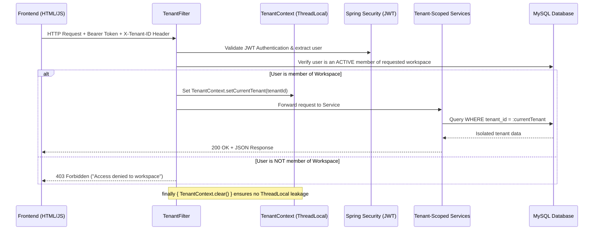

# NexSpace | Multi-Tenant Workspace & Team Collaboration SaaS

A production-grade, multi-tenant workspace application built with **Spring Boot 3** (backend) and **HTML5, CSS3, and JavaScript** (frontend), implementing a **Shared Database with Discriminator Column (`tenant_id`)** multi-tenancy strategy.

---

## 🏛️ Multi-Tenancy Architecture

### 1. Data Isolation Model: Shared Database with Discriminator Column
- **Shared Schema**: Every tenant-scoped entity (`Project`, `Task`, `ActivityLog`, etc.) inherits from `BaseTenantEntity` which enforces a `tenant_id` column.
- **Automatic Partition Stamping**: When saving entities, `@PrePersist` automatically stamps `tenant_id` from `TenantContext.getCurrentTenant()`.
- **Tenant Isolation Enforcement**: Service and repository layers strictly scope queries by `tenantId`. A user from `tenant_A` can never read, modify, or delete data belonging to `tenant_B`.

### 2. Request Lifecycle & Tenant Context


---

## 🚀 Key Features

### 🏢 Workspace & Tenant Management
- **Instant Workspace Onboarding**: Self-service workspace creation with automatic slug generation (e.g. `acme-studio`).
- **Workspace Switcher**: Seamlessly switch between multiple workspaces without re-authenticating. The UI dynamically adjusts `X-Tenant-ID` and hot-reloads data.
- **Tenant Settings & Tier Upgrades**: Toggle between FREE, PRO, and ENTERPRISE tiers.

### 👥 Role-Based Access Control (RBAC) & Isolated Data Roles
- **OWNER**: Full administrative control across the entire company tenant, manage billing/plans, invite admins, and delete the workspace.
- **ADMIN**: Manage company settings, invite teammates, create projects and tasks.
- **BILLING_ADMIN**: **Isolated Financial Role** — Has exclusive access to upgrade/downgrade Stripe plans, view billing receipts, and trigger payment webhooks, but is strictly isolated from deleting or altering engineering projects and tasks!
- **MEMBER**: Standard collaborator — Create, update, and move projects and tasks across Kanban boards.
- **VIEWER**: Read-only auditor — Can view tasks, projects, and activity reports without mutation rights.

### 💳 Stripe Billing & Payment Webhooks
- **Stripe Subscription Tiers**: Starter ($0/mo), Professional ($29/mo), Enterprise ($99/mo).
- **Asynchronous Payment Webhooks**: Handles Stripe events with signature verification:
  - `checkout.session.completed` -> Upgrades company plan and stores `stripe_customer_id` and `stripe_subscription_id`.
  - `customer.subscription.updated` -> Synchronizes subscription tier changes.
  - `customer.subscription.deleted` -> Reverts company to Free tier.
  - `invoice.payment_succeeded` -> Logs payment receipt into the tenant activity log.
  - `invoice.payment_failed` -> Marks company as `PAST_DUE`.
- **1-Click Webhook Simulator**: Built-in interactive webhook simulator to test events without `ngrok` or Stripe CLI.

### 🎓 Interactive Architecture Learning Lab
- **Request Lifecycle Visualizer**: Inspects the 5-stage pipeline from HTTP header to ThreadLocal and SQL execution.
- **Interactive RBAC Matrix & Sandbox**: Test any role against any permission to see real-time access decisions and explanations.
- **Webhook Event Playground**: Trigger sample Stripe payloads and inspect the raw JSON and database reactions live.

### 📋 Interactive Kanban Board & Task Management
- **Kanban Columns**: `To Do`, `In Progress`, `In Review`, and `Done`.
- **Drag-and-Drop**: Native HTML5 drag-and-drop state transitions with optimistic UI updates.
- **Filters & Search**: Live search tasks across title & description; filter by Project.
- **Task Metadata**: Priority pills (Urgent, High, Medium, Low), Assignee avatars, Due date chips.

### 📊 Overview & Real-Time Metrics
- **Metric Cards**: Total projects, total tasks, completed tasks, and completion velocity rate.
- **Task Status Distribution**: Visual progress tracks for task completion.
- **Workspace Activity Audit Log**: Chronological audit trail of all workspace actions.

---

## 🛠️ Tech Stack

| Layer | Technologies |
|---|---|
| **Backend** | Java 17+, Spring Boot 3.2.0, Spring Security, Spring Data JPA, Hibernate 6, JJWT 0.11.5 |
| **Frontend** | HTML5, CSS3 (Custom Design System, Dark Mode), Vanilla JavaScript (ES6+ Modules, Fetch API) |
| **Database** | MySQL 8.0 (configured with auto-create database support) + H2 (runtime option) |
| **Icons & Fonts** | Font Awesome 6.5, Plus Jakarta Sans, JetBrains Mono |

---

## ⚙️ Configuration (`src/main/resources/application.yml`)

```yaml
server:
  port: 8085

spring:
  datasource:
    url: ${DATABASE_URL:jdbc:mysql://localhost:3306/multi_tenant_workspace_db?createDatabaseIfNotExist=true&useSSL=false&allowPublicKeyRetrieval=true&serverTimezone=UTC}
    username: ${DATABASE_USERNAME:root}
    password: ${DATABASE_PASSWORD:your_db_password}
    driver-class-name: com.mysql.cj.jdbc.Driver
  jpa:
    hibernate:
      ddl-auto: update
```

---

## 🏃 Running the Application

### Option 1: Double-click Batch Launcher (Windows)
Double-click `start.bat` in the project root folder.

### Option 2: Using Maven Command Line
```powershell
# From C:\Users\bibek\Desktop\multi-tenant-workspace
& "C:\Users\bibek\Desktop\apache-maven-3.9.12-bin\apache-maven-3.9.12\bin\mvn.cmd" spring-boot:run
```

### Option 3: Running Packaged JAR
```powershell
java -jar target/multi-tenant-workspace-1.0.0.jar
```

Once started, open your web browser to:
👉 **`http://localhost:8085/`**

---

## 🧪 Quick Test & Multi-Tenancy Verification Guide

1. **Sign In / Auto-Register**:
   - Open `http://localhost:8085/`.
   - The default credentials `alex@example.com` / `password123` are pre-filled.
   - Click **"Sign In"**. It will automatically initialize the user and create their default workspace **"Acme Studio"** with seeded projects and tasks.

2. **Test Workspace Switching**:
   - Click the workspace switcher dropdown at the top of the sidebar.
   - Click **"+ Create New Workspace"**.
   - Enter name: `Alpha Corp` (slug: `alpha-corp`).
   - Notice the workspace switches immediately. Notice the green indicator displays `ACTIVE TENANT ID: ws_xxxxxx` and `topbar` shows `Tenant: alpha-corp`.
   - The project and task list are completely isolated from Acme Studio!

3. **Verify Data Isolation**:
   - In `Alpha Corp`, create a task: `"Alpha Confidential Initiative"`.
   - Switch back to `Acme Studio`.
   - Verify that `"Alpha Confidential Initiative"` does **not** appear in Acme Studio!
   - Switch back to `Alpha Corp`, and your data is preserved.

4. **Test Member Invitations & RBAC**:
   - Navigate to the **"Team Members"** tab.
   - Click **"Invite Member"**, enter `sarah@example.com` with role `MEMBER`.
   - Test promoting/demoting roles or removing access.
